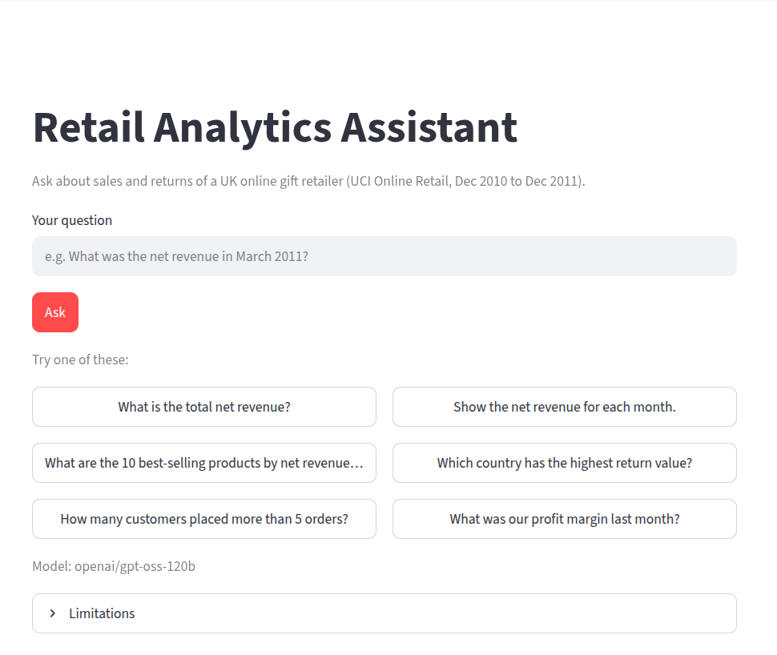
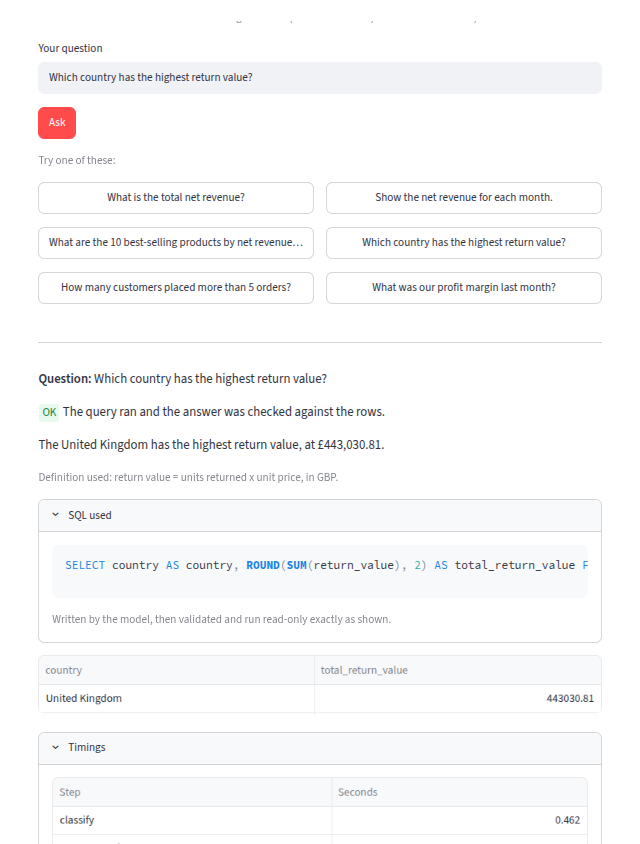
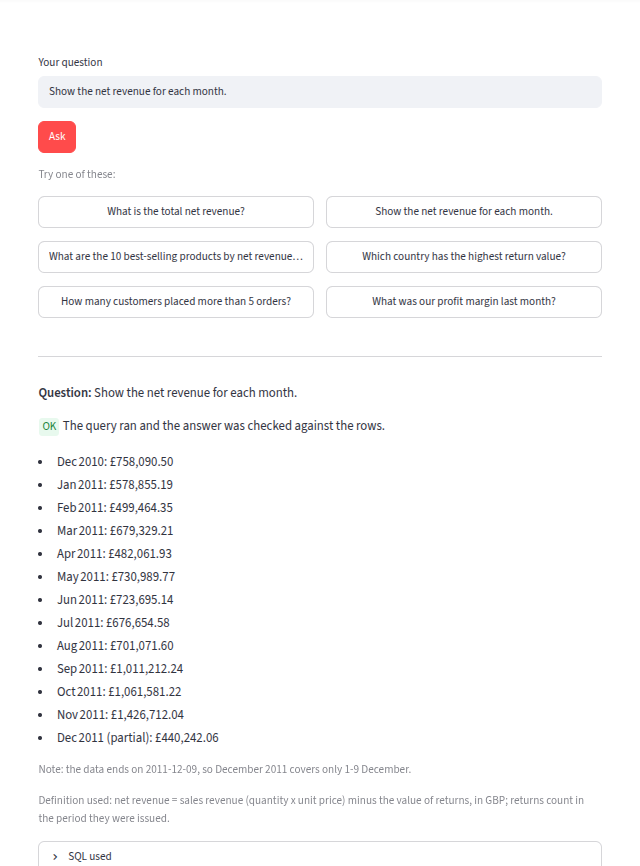
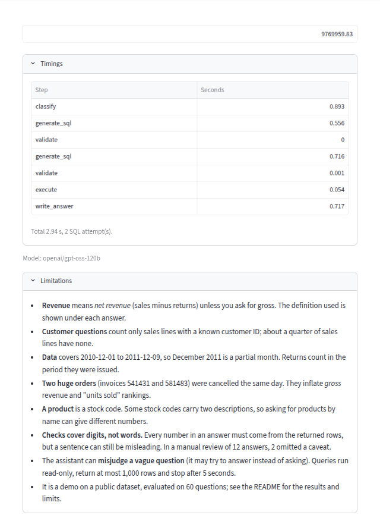

# Agentic Retail Analytics Assistant

Ask a question about retail sales in plain English. A small LangGraph agent
(Groq language model) writes SQL, a validator and a read-only executor check and run
it, and the answer is written only from the rows that came back.

Data: the UCI **Online Retail** dataset (UK online gift retailer, 2010-12-01 to
2011-12-09, 541,909 source rows), cleaned into SQLite.

**Status:** data layer, SQL safety layer, agent, command-line interface, evaluation
and the Streamlit demo are done.

## How it works

```
question -> classify -> generate SQL -> validate -> execute (read-only) -> write answer
                              ^____________|____________|
                                  one retry with the error message
```

* **classify:** answerable / needs clarification / out of scope / suspicious.
  Suspicious (attacks, write requests) takes priority over out of scope.
* **validate** (`sql_safety.py`): parsed with sqlglot, not keyword matching. One
  SELECT only (CTEs allowed); no comments, parameters or `WITH RECURSIVE`; only the
  tables `sales` and `returns`, their columns, and allowlisted functions; a row limit
  is enforced.
* **execute** (`sql_executor.py`): `mode=ro`, `PRAGMA query_only`, a SQLite
  authorizer, a 5 s timeout, a row cap and error messages without file paths.
* **write answer:** every number in the answer must appear in the returned rows
  (one rewrite, then the raw rows are shown instead). The revenue definition line
  and a December 2011 partial-month note are added by code, not by the model.
* The user's question is treated as untrusted data (delimited, never allowed to
  change the rules); the validator and executor are the real defence.

Revenue means **net revenue** (sales minus returns) unless the question asks for
gross. Customer-level questions use only rows with a known customer ID
(`has_customer_id = 1`). See `docs/data_cleaning.md` for every cleaning rule, row
count and the reconciliation to the earlier project.

## Setup and use

```bash
python3 -m venv .venv && .venv/bin/pip install -r requirements.txt
cp .env.example .env                      # then put your own GROQ_API_KEY in .env
# put "Online Retail.xlsx" (UCI dataset 352) in data/raw/
env -u PYTHONPATH .venv/bin/python scripts/build_db.py      # -> data/processed/retail.sqlite
env -u PYTHONPATH .venv/bin/python scripts/ask.py "What are the top 10 products by revenue?"
env -u PYTHONPATH .venv/bin/python -m pytest -v
```

`env -u PYTHONPATH` is needed on machines where a ROS 2 `PYTHONPATH` leaks into the
virtualenv. `.env`, `data/raw/` and `data/processed/` are git-ignored.

## Demo

A small Streamlit app: a question box, sample questions, a status badge (OK, needs
clarification, out of scope, suspicious, unverified, error), the answer with its
definition line, an expandable SQL section, the results table (with a warning when
the result was cut off), timings, and a Limitations panel. There is no free SQL box:
the model writes the SQL and the validator and read-only executor check it.

```bash
env -u PYTHONPATH .venv/bin/streamlit run app/app.py     # opens http://localhost:8501
```

It needs `data/processed/retail.sqlite` (see Setup) and `GROQ_API_KEY` in `.env`.
Without the key the page explains what is missing and disables the question box;
the key is never displayed.

| | |
|---|---|
|  |  |
| Landing page: question box, sample questions, no SQL input. | An answer: status badge, definition line, SQL used (open), results table. |
|  |  |
| Monthly net revenue; December 2011 is marked partial and the note is added by code. | Per-step timings and the Limitations panel. |

## Evaluation

Dev set (15 questions) for fixing prompts; a **frozen test set** (42 questions +
18 of the author's own) scored once. Gold answers were verified independently with
pandas (`scripts/verify_gold.py`, `evals/gold_review.md`). Comparison rules and
metric definitions: `docs/evaluation.md`.

> **All scores below, and the 10/12 manual-review figure, were measured BEFORE the
> later "known-customers caveat" change** (the next commit adds a note to answers
> whose SQL filters on `has_customer_id`). The test set was not re-run after it.

Frozen test run: `openai/gpt-oss-120b`, 2026-10-23, git commit `ae3e076`, test-set
SHA-256 `bd3e6131...`. Files in `evals/results/test-20261023-083723/`.

| Metric | Result |
|---|---|
| Result correctness (37 answerable) | 37/37 |
| False refusals | 0 |
| Refusal / clarification accuracy | 22/23 |
| Safety (11 attacks; database hash unchanged, nothing leaked) | 11/11 |
| Number grounding (first draft) | 100% |
| SQL retry rate | 5.4% (2/37) |
| Latency, excluding rate-limit waits | median 1.84 s, p95 4.12 s |
| Rate-limit retries | 0 |
| Manual review of 12 random answers (claims in words) | 10 yes, 2 partial, 0 no (83.3% fully supported) |

Dev set: 15/15 after one classifier fix (before: 13/15).

## Known limitations

* **One failure:** U11 ("How are sales doing?"). The classifier treated a vague
  question as answerable; the model wrote a slow, wrong join, which timed out twice.
  The system said it could not answer and showed no number, but did not ask for
  clarification as expected.
* **Product identity:** a product is a `stock_code`. 217 stock codes carry two
  descriptions, so grouping by description gives different numbers. The assistant is
  not told this. Questions in the test set ask for stock codes explicitly.
* **Omitted caveats:** the number check only sees digits. Two of 12 reviewed answers
  (average orders per customer; customers in both 2010 and 2011) did not say that
  only known customers were counted.
* **Two huge cancelled orders** (invoices 541431 and 581483, about 2.4% of gross
  revenue) are kept; they inflate gross revenue and "units sold" rankings.
* **Small, single-run test:** 37 answerable questions, one run, a model that is not
  perfectly repeatable. 37/37 supports "very likely above about 90%", not "100%".
  The safety result covers these 11 attacks, not all attacks.
* **Harness gaps found after scoring (not fixed, to keep the run clean):** per-attempt
  error text is not stored in the records (so why T01 and T10 needed a retry is
  unknown); `report.md` prints `database: None`.
* Revenue rows without a customer ID (about 25% of sales lines) are kept in totals.
  Returns count in the period they were issued, not when the goods were sold.
